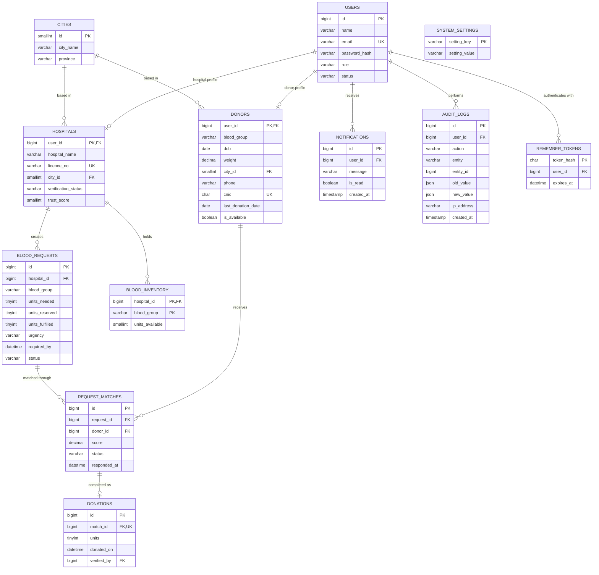

# DonorNexa relational ERD

The diagram shows the core 3NF relationships. Names, roles, contact profiles and request state are separated so that account credentials are not repeated across role-specific records.

## Relationship and normalization notes

- Each `users` row has one role; role-specific donor and hospital attributes live in a one-to-one profile table. This avoids nullable donor/hospital columns on every account.
- `city_id` references one canonical city row, and hospital city is used for request matching; the request table does not duplicate city name/province.
- A request-to-donor relationship is many-to-many and is represented by `request_matches`, with a unique `(request_id, donor_id)` key and relationship attributes such as score, response state and response time.
- A donation is tied to one accepted match. `UNIQUE(match_id)` prevents recording the same match twice.
- Blood inventory is keyed by `(hospital_id, blood_group)`; changing stock does not require adding a new column for each blood group.
- `system_settings` stores mutable cooldown and ranking configuration. `v_eligible_donors` reads the configured cooldown; `trg_donation_updates_donor` maintains the donor's latest donation date.
- The audit log captures who performed a change and when. `old_value`/`new_value` are JSON because changes differ by entity type; they are not used as normalized business attributes.

## Index justification

- `users(email)` and profile licence/CNIC columns are unique lookup and duplicate-prevention keys.
- `donors(blood_group, city_id, is_available)` and `donors(last_donation_date)` support candidate discovery and eligibility.
- `blood_requests(status, urgency, required_by)`, `(hospital_id, status, created_at)` and `(blood_group, urgency, required_by)` support the public board, hospital dashboard and request filtering.
- `request_matches(request_id, status)` and `(donor_id, status, created_at)` support donor and hospital work queues.
- Audit and notification indexes follow the common time/user filters used by their respective dashboards.
